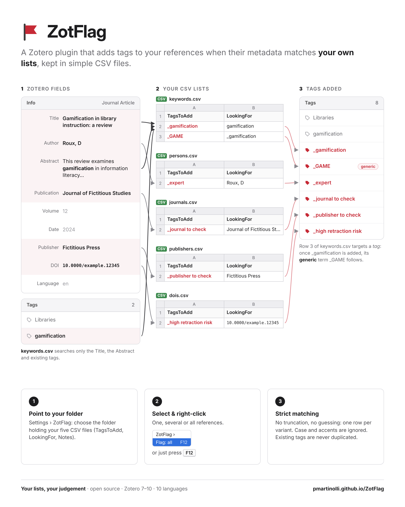

# ZotFlag
A Zotero plugin to index tags automatically based on authors, publishers, DOI, journals and keywords found in csv concordance tables.

---

Zotero Extension (7 to 10) that automatically adds tags to selected references when their metadata matches lists kept in CSV files.

### Installation

Zotero > Tools > Plugins > gear icon > "Install Plugin From File…" > `zotflag-...xpi`.

### Configuration

Zotero > Settings > ZotFlag:

* CSV file location (Browse… button);
* Name of the tag column and the target column (empty = default name for the Zotero language, e.g., Marqueur/Cible in French, TagstoAdd/LookingFor in English);
* Button to create missing model/template CSV files.

Examples are provided in this repo. 

### License

GPL-3.0-or-later. Author: Pascal Martinolli (specifications); code generated with Claude.

