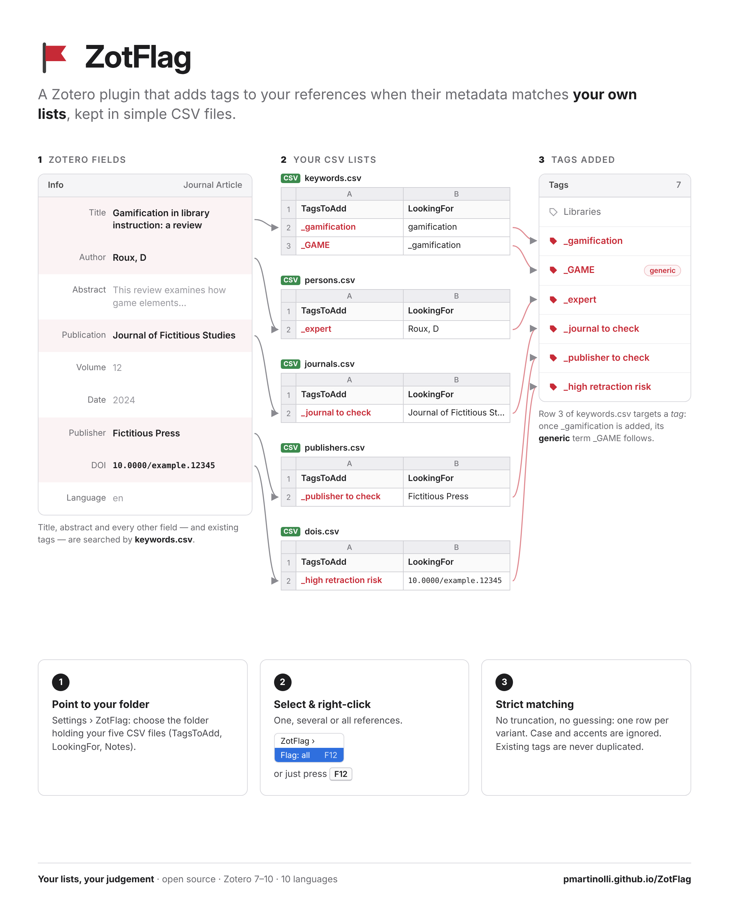

Zotero Extension (7 to 10) that automatically adds tags to selected
references when their metadata matches lists kept in CSV files.

- [GitHub Repository](https://github.com/pmartinolli/ZotFlag)
- [Specifications](https://pmartinolli.github.io/ZotFlag_cahierdescharges/)
  (Pascal Martinolli, 2025).

GPL-3.0-or-later. Author: Pascal Martinolli (specifications); code
generated with Claude.

\* : « Make it so. » was a catchphrase written by Gene Roddenberry,
[inspired](https://en.wiktionary.org/wiki/make_it_so) by the British
naval officers of the XIXe century. It was first used in "Encounter At
Farpoint" (28 September 1987) and then reused with much delight by
Captain Jean-Luc Picard (*In memoriam*) during the run of
[ST:TNG](https://www.startrek.com/en-ca/videos/make-it-so-captain-picard)
1987-1994.
