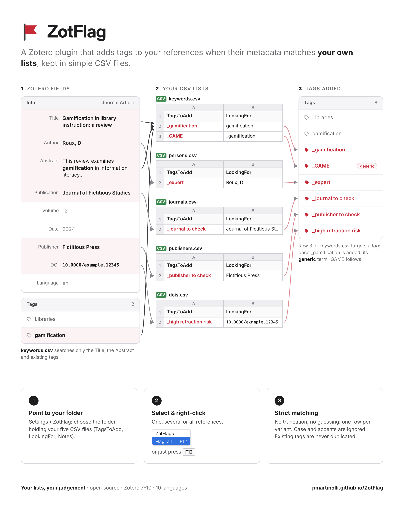

It is a Zotero extension (for Zotero 7 to 10) that automatically adds
tags to selected references when their metadata matches lists kept in
CSV files.

- [GitHub Repository](https://github.com/pmartinolli/ZotFlag)
- [Discussion, application and empirical
  analysis](https://pmartinolli.github.io/blog/2026/ZotFlag/) (in
  French).

+----------------------------------+-----------------------------------+
| CSV filenames                    | Matching Zotero fields            |
+==================================+===================================+
| `keywords.csv`                   | Tags (strict equality)            |
|                                  |                                   |
|                                  | Title (whole word or phrase)      |
|                                  |                                   |
|                                  | Abstract (whole word or phrase)   |
+----------------------------------+-----------------------------------+
| `journals.csv`                   | Publication title (journal, book, |
|                                  | proceedings, website…) and        |
|                                  | journal abbreviation              |
|                                  |                                   |
|                                  | ISSN                              |
+----------------------------------+-----------------------------------+
| `persons.csv`                    | All creators (author, editor,     |
|                                  | other roles), target in *Last     |
|                                  | Name, First Name* format          |
+----------------------------------+-----------------------------------+
| `publishers.csv`                 | Publisher (and equivalent fields: |
|                                  | university, institution, label…)  |
+----------------------------------+-----------------------------------+
| `dois.csv`                       | DOI field\                        |
|                                  | `DOI:` line in the Extra field\   |
|                                  | doi.org in URL field              |
+----------------------------------+-----------------------------------+
| `urls.csv`                       | URL                               |
+----------------------------------+-----------------------------------+

**Usage** : Right-click + ZotFlag. Or F12 keyboard shortcut (to index
all).

**Language** : The interface (menu, messages, settings, template files)
follows the language selected in Zotero: English, French, Spanish,
German, Italian, Portuguese (Brazil and Portugal), Dutch, Japanese,
Simplified Chinese. For any other language, ZotFlag is displayed in
English (or in the closest variant). To add a language: copy
`locale/en-US/zotflag.ftl` to `locale/<code>/` and translate it.

**Columns** : TagsToAdd/, LookingFor, and any other column (e.g., Notes)
ignored. One line = one tag for one target; repeat the line for multiple
tags or multiple variants. Non case sensitive. No accent sensitive. No
truncation/ No wildcard.

### Matching Rules (Strict Only)

- No truncation, no automatic variants: create one line per variant
  yourself.
- Ignored: case, accents and ligatures (é = e, ç = c, œ = oe), multiple
  spaces, typographic apostrophes/hyphens, HTML tags like `<i>`, etc.
- Persons: `Roux, D` matches `Roux D` (and "Roux D.") but not
  `Roux Damien`. A target without a comma matches a name in a single
  field (institution).
- `keywords.csv`: The term must appear as a whole word/phrase ("jeu de
  rôle" does not match "jeux de rôle" nor "jeu de rôles"). A target that
  is an existing tag (e.g., `_jeu de rôle`) allows adding a generic tag
  (e.g., `_JEU`); additions can chain together (multiple levels
  possible).
- An already existing tag is never duplicated. Read-only libraries are
  ignored.
- Comma, semicolon, or tab separator detected automatically; UTF-8
  (fallback Windows-1252).

GPL-3.0-or-later. Author: Pascal Martinolli (specifications); code
generated with Claude.

------------------------------------------------------------------------

« Make it so. » was a catchphrase written by Gene Roddenberry,
[inspired](https://en.wiktionary.org/wiki/make_it_so) by the British
naval officers of the XIXe century. It was first used in "Encounter At
Farpoint" (28 September 1987) and then reused with much delight by
Captain Jean-Luc Picard (*In memoriam*) during the run of
[ST:TNG](https://www.startrek.com/en-ca/videos/make-it-so-captain-picard)
1987-1994.
